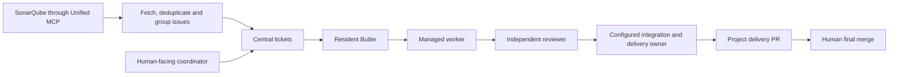

# Sonar–ADO VM source and operations

## Repository purpose

This repository versions the existing autonomous SonarQube–Azure DevOps
deployment alongside its upstream Pursers baseline. The 2026-10-25 import is a
source migration only. It does not install packages, migrate Central, change
membership or delivery policy, restart services, invoke a model, or resume work.

The VM already reported product version **5.2.1**. Its exported source had local
changes, and Butler also imported an older coordinator from a separate clone.
The package version alone therefore did not identify the code being executed.
Use Git commits and deployment receipts to identify future installations.

## Provenance and branches

| Reference | Meaning |
| --- | --- |
| `v5.2.1` | Original upstream release, commit `3575b04bc7054fc5481024c181fe9efa2d8b898b` |
| `codex/vm-snapshot-20261025` | Exact captured VM source over the release baseline, commit `859632cf1399b26f0703aac4e8d5ea839c3131f0` |
| `main` | Upstream main at `099ea2cc4e6392266eb3a34089d5216dff55faa9`, merged with that VM snapshot and import bookkeeping |

The capture contains **915 regular source files**. Compared with `v5.2.1`,
16 existing files changed, 5 files were added, and none were missing. Each
captured file was verified by SHA-256 before the snapshot commit was created.
The [import manifest](vm-import-20261025.json) records the input references,
archive digest, and the changed-file digests. The snapshot branch retains
original bytes, including stale generated metadata and a trailing blank line.
Main refreshes `INTEGRATION_FILES.sha256` using its supported generator and
normalizes the blank line. A subsequent validation repair rebuilds the private
component lock and restores the paired recovery tests, as described below.
The captured VM snapshot remains unchanged.

The original Azure repository refs were backed up in a private, verified Git
bundle before replacement. That backup is kept outside the repository. The
replacement uses main as the default branch. Deleting the two legacy branches
and twelve legacy tags was rejected with `forcePushRequired` / `TF401027`:
the current account lacks Azure Git `ForcePush` permission. Those refs remain
historical references and are not the default source. Their deletion is a
separate repository-owner cleanup; no permissions were elevated by this import.
No new product release or version bump is implied by this import.

Inspect the imported delta:

```sh
git diff --stat v5.2.1 codex/vm-snapshot-20261025
git diff v5.2.1 codex/vm-snapshot-20261025 -- tools/board-butler
git diff codex/vm-snapshot-20261025 main
```

The upstream delta comprises explicit-null periodic budgets, model-output
compaction, registry action scope and per-board failure isolation, stale-seat
recovery, event-seat preflight, and a provisioning helper with tests. Presence
in this import does not establish that a helper is wired into the live resident
or that every imported feature has passed a production acceptance test.

## Two intake routes



The Sonar route needs a verified Sonar project, Azure project/repository and
mapped base branch, plus credentials authorized for those resources. A PAT's
visibility does not itself configure or authorize intake for every project.
Grouping turns compatible occurrences into repair tasks; it does not close or
remove Sonar issues merely by reading them.

The coordinator route feeds requirements into Central. Scheduling still needs
valid ticket scope, dependencies, membership, available templates and credentials
for the actors that actually read or push repository content. Central credentials
and Azure credentials have different purposes. The intended delivery owner must
be explicit; this import does not transfer repository credentials to Butler or
establish coordinator-owned delivery automatically.

The intended project boundary is a Pursers-owned integration/delivery branch
derived from the mapped base, with the final environment merge left to the
project owner. Aggregate delivery and per-ticket delivery remain configuration
choices. The observed frontend configuration has not yet been aligned with the
requested aggregate flow.

## Configuration and durable state

Keep actual credentials and live state outside Git. Portable examples already
exist in the source; they are templates, not the captured VM configuration.

| Component | Configuration or state to account for |
| --- | --- |
| Central | Board SQLite database, archive, journal, board membership and scoped credentials |
| Registry | Central `project_registry` is authoritative; a disk seed can be stale |
| Connectors | Private `butler-connectors.json`: Unified MCP endpoint/auth references, tool allowlist, Sonar source mappings and PR writeback |
| Sonar onboarding | Private onboarding JSON: project/repository mapping, base/integration refs, board membership and `default_ticket_tier` |
| Resident Butler | User service arguments including `--repo`, `--connector-config`, `--source-intake-index-file`, `--intake-onboarding-config`, runtime mode and executor bindings |
| Shared fleet | Control-board desired bounds/envelope, authorization grant, owner-only observation config, executor policy/database, templates, cursors and receipts |
| Delivery | Registry project delivery policy/workflow, integration state and publication receipts |

See the [connector example](../../tools/board-butler/examples/connector-source-config-v1.json),
[onboarding example](../../tools/board-butler/examples/source-onboarding-config-v1.json),
and [shared fleet guide](shared-registry-fleet.md). Source examples default to
inactive behavior and must be adapted to the actual connector tool schemas.

Use external private configuration paths such as `/PATH/TO/private/config` and
owner-only credential files. Do not commit PATs, JWTs, SSH keys, real endpoint
secrets, database/WAL files, executor state, customer checkouts, or copied runtime
backups. Existing credential files in a local working directory are not source.
The migration's local Git exclude protects the pre-existing operator key files.

Changing a JSON seed alone does not update the Central registry. Admin on one
board does not confer admin on another. Distinguish principal membership, seat
role, capability and token scope when diagnosing admission.

## Observed runtime and outstanding recovery work

These observations describe the read-only audit on 2026-10-25; they are not a
deployment acceptance result:

1. Butler is stopped after `ValueError: pursers: ticket tier is invalid`.
   Stored hot-ticket tiers were valid. Central can return an
   `oversized_for_list` stub without `tier`; the coordinator's count comparison
   mistakes ID coverage for complete scheduling fields, and Butler raises on
   that missing field. The source mechanism is confirmed; the exact offending
   response at the final crash was not retained. Repair and verify the read/
   completeness boundary rather than rewriting stored tiers.
2. The installed source reports 5.2.1, but Butler's `--repo` loads coordinator
   code from a separate 5.0.8 clone at
   `7471a7349556e0f32513ab1a4a5098f2f0141703`. The coordinator daemon uses the
   exported 5.2.1 source. Align actual import targets in a reviewed deployment;
   installing a version label alone will not do this.
3. Existing work includes `needs_human` tickets. Restarting scheduling will
   not answer unresolved application requirements or test-baseline questions.
4. Root default tier is 1, while Sonar onboarding and existing frontend tickets
   use tier 2. The observed runner is Goose event seats, with ACP worker pool
   zero. One Sonar source is configured; broad PAT visibility is not active
   multi-project intake.
5. The frontend registry route now points at the shared control board; an older
   empty board and a stale admission-blocked intake record remain. Its delivery
   policy is still direct/per-ticket against main. Backend integration uses a
   Pursers integration branch with automatic integration disabled.
6. The imported provisioning helper has incompatible role/ownership assumptions
   for the current frontend setup and is not called by the resident main path.
   Do not execute historical recovery scripts against newer state blindly.

Historical archives establish that the earlier backend route completed
49 independently approved tickets. A retained publication record consolidates
40 source PRs into one delivery PR. Those are historical records, not proof
that either present intake route is healthy or that the customer merged it.

## Verification and future deployment

The Azure project had no configured build definitions or pipelines at import.
The inherited `.github/workflows` describe upstream GitHub automation; pushing
this private Azure repository does not create a GitHub Actions run or deploy
the VM. Upstream CI badges do not validate this fork.

Repository checks:

```sh
python3 tools/leak_scan.py
python3 tools/ci_manifest.py check
git diff --check
```

Run affected tests against this checkout's client and Central packages, with
the declared MCP dependency. Record environment, exact candidate SHA and test
results. Do not describe a source-only import as a green runtime or a release.

The initial focused import check on macOS with Python 3.14.8 and MCP 2.2.0 returned
**580 passed, 2 failed, 1 skipped**. Both failures are the `ready`/`draining`
variants of `test_verified_process_loss_advances_incarnation_once` in
`tools/board-butler/tests/test_fleet_observation.py`: the imported fixture
inserted 13 values into a 14-column `seats` table. The initial capture retained
that inconsistency; the follow-up repair is described below.
Source-byte verification, secret scanning and the integration manifest check
passed. These checks do not validate the stopped resident's end-to-end flow.

All 14 Python suites were also run. After rechecking Home acceptance against
the completed import commit, the combined suite results are **4,149 passed,
5 failed, 12 skipped** (excluding separately reported subtests). These historical
results combine the full run and the affected-suite recheck, not a single green
gate. The five failures at that point were:

- The two fleet-observer fixture/schema failures described above.
- One macOS ACP sandbox standalone-commit test (`CalledProcessError`). Its
  cause had not yet been diagnosed; it did not establish a VM failure.
- The release-train check rejects stale source digests in `component-lock.json`.
- The Personal MCP receipt test rejects the modified client artifact against
  that same release-owned component lock.

The first Home-acceptance run captured the pre-bookkeeping merge SHA, causing
23 additional candidate-whitespace failures. Those 23 passed when rerun on
the completed import commit. Do not disable the artifact checks to obtain a
green gate. No lock regeneration or package version bump was performed during
the initial source capture.

## Validation repair and VM test selection

The follow-up repair addresses the five validation failures without changing
package versions or deploying to the VM:

- Use the VM repair's existing column-named observer fixture, which allows the
  executor's added `reactivation_attempts` column to retain its default. The
  original `ready` and `draining` process-loss checks both pass.
- Follow intermediate executable symlinks when building sandbox metadata rules.
  Real macOS tests start both direct and chained virtualenv launchers and commit
  in the ticket clone. They also verify that operator Git configuration and an
  unrelated file next to an intermediate link cannot be read. File-content
  permissions, network denial and protected-file denial remain enforced.
- Rebuild `component-lock.json` with `tools/regenerate_component_lock.py` and
  the existing pinned build toolchain. The lock now covers the imported Client's
  new `model_output.py` and the modified Central/Client members. Drift detection
  remains enabled. These rebuilt artifacts belong to this private source fork;
  they do not replace upstream PyPI artifacts under the same version numbers.

Read-only SSH inspection found four missing regression-test files in the
retained stale-seat repair. Their three paired production files are byte-for-
byte identical to the imported VM production code. The useful tests were
therefore restored, together with the already-corrected observer fixture.
Their focused suites pass 83 checks against this checkout, using disposable
test state. See the [test provenance](vm-repair-tests-20261025.json). The Butler
test formerly named `test_stale_restart.py` is stored as
`test_stale_seat_inventory.py` to avoid colliding with the seat-kit helper module.

During the initial validation repair, the uninstalled projection v3 and approval-audit v3 stages were retained
and inspected privately. They are not simply tests for the installed version.
Projection v3's full coordinator file derives from the older 5.0.8 clone, while
this repository contains the 5.2.1 coordinator. Its patch can pass an application
check against the current source, but copying its full file would replace newer
code. Approval v3 also changes production behavior. Their combined consumer
integration and live acceptance remain incomplete in the handoff. Neither
candidate was included merely because of its version label or a scoped test log.
The subsequent [projection recovery](PROJECTION-RECOVERY-5.2.1.md) forward-ports
their scoped patches and supplies the missing consumer integration, bounded
cursor traversal and dual-intake checks. The original captured source remains
available on its snapshot branch.

The full manifest suite must pass on the final repair commit before integration.
This source validation does not establish that the stopped resident's projection
crash, delivery policy or human-blocked application tickets have been repaired.

Before a later operator-authorized deployment:

1. Resolve and independently verify the recovery items above. Keep the exact
   original VM snapshot for comparison.
2. Save live configuration, membership, revisions, grants, unit definitions,
   import targets, durable state and active leases. Use a SQLite-consistent
   backup; copying only a database file while it uses WAL is insufficient.
3. Build from an exact reviewed Git commit into a separate release directory.
   Record source SHA, artifact hashes and package versions. Point every
   applicable import target to the intended release.
4. Change services only with explicit deployment authority. Preserve leases
   and rollback material. Do not point a running unit at a mutable worktree.
5. Verify both intake routes, grouping, worker/reviewer separation, scheduling,
   limits and project-specific delivery. Distinguish ticket approval, branch
   integration, PR publication and the human's final merge.

Rolling back Git refs does not roll back SQLite state, credentials or service
configuration. Recover the old Azure refs from the private bundle only if
needed, using targeted ref updates rather than an unrestricted mirror push.
